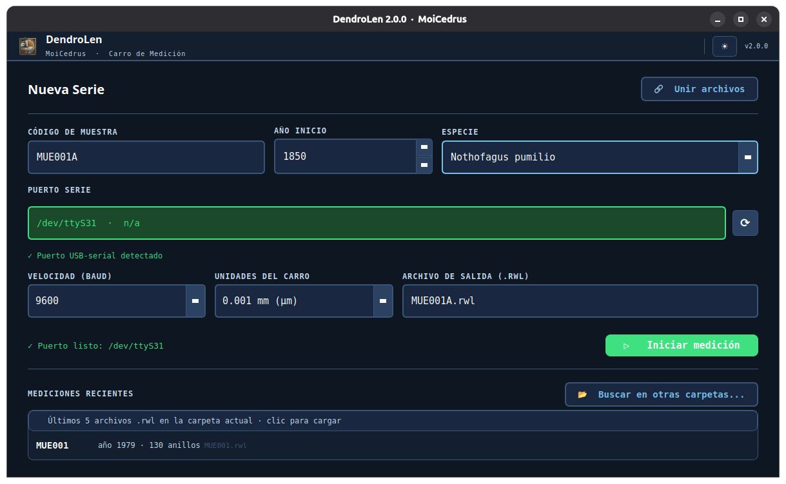
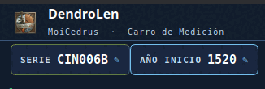
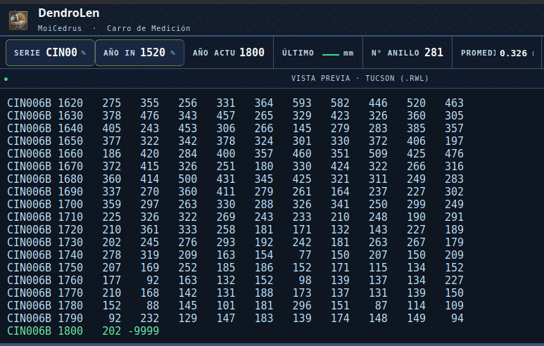
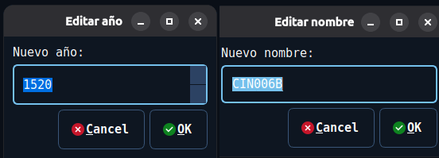

# Manual de DendroLen

Esto es la receta, no la referencia. Si buscas la lista completa de funciones,
está en el [README](README.md); si buscas qué cambió entre versiones, en el
[CHANGELOG](CHANGELOG.md). Acá está lo que necesitas para sentarte frente al
carro y medir.

---

## Lo que hace, en una línea

Lee el encoder del carro de medición por el puerto USB-serial, arma la serie
anillo por anillo, te muestra cómo va cofechando contra una maestra mientras
mides, y la escribe en Tucson `.rwl`.

---

## Antes de empezar

Necesitas el carro con encoder VRO y su adaptador USB-serial (FTDI, CH340,
CP210x). Nada más.

---

## Instalar

Todo se descarga desde **<https://rojasbadillamoi.github.io/>**, en la
**[página de DendroLen](https://rojasbadillamoi.github.io/DendroLen/)**.

**Se instala como cualquier otro programa: doble clic y seguir los pasos.**

| Sistema | Archivo | Qué hacer |
|---|---|---|
| **Windows 10/11** | `.exe` | Doble clic en el instalador y siguiente, siguiente. DendroLen queda en el menú de inicio. |
| **Debian / Ubuntu** | `.deb` | Doble clic: lo abre el Centro de Software (o GDebi, o el gestor que tengas) y le das instalar. DendroLen queda en el menú de aplicaciones, con su ícono en el dock. |

No hay que instalar Python ni nada más: los dos paquetes traen todo lo que
necesitan.

> **Si Windows te muestra un aviso azul** que dice que no reconoce el programa,
> es porque el instalador no está firmado digitalmente —firmarlo cuesta una
> licencia anual—. Clic en **Más información → Ejecutar de todas formas**.

Si prefieres la terminal, el `.deb` también se instala así, y `apt` resuelve
las dependencias solo:

```bash
sudo apt install ./dendrolen_*.deb
```

### El permiso del puerto serie, en cualquier Linux

Esto hay que hacerlo **sin importar cómo instalaste**, y es lo que más
confusión causa: tu usuario necesita permiso para leer el puerto serie. Si el
carro no aparece en la lista de puertos, casi siempre es esto y no el hardware.

```bash
sudo usermod -aG dialout $USER     # y cerrar sesión para que tome efecto
```

Hay que cerrar sesión de verdad —o reiniciar—: abrir otra terminal no basta.

### Desde el código fuente

Para macOS, para otras distribuciones de Linux, o si quieres modificar el
programa. Necesitas Python 3.10 o superior. El `.zip` del código está en la
misma página, o clonas el repositorio:

```bash
git clone https://github.com/rojasbadillamoi/DendroLen.git
cd DendroLen
python3 -m venv venv && source venv/bin/activate
pip install -r requirements.txt
python3 main_dendro.py
```

En Ubuntu y Debian, si `venv` reclama, instala antes `python3-venv`.

---

## 1. Preparar la serie

Al abrir el programa aparece esta pantalla. Es todo lo que hay que llenar antes
de medir.



| Campo | Qué poner |
|---|---|
| **Código de muestra** | El identificador de la serie, hasta 8 caracteres (`MUE001A`). El último grupo de letras es el radio. |
| **Año de inicio** | El año del **primer anillo que vas a medir**. Si mides desde la médula, ese es el año de médula. |
| **Especie** | De la lista o escrita a mano. Las que agregues quedan guardadas para la próxima vez. |
| **Puerto serie** | Se detecta solo. El botón ⟳ vuelve a buscar si enchufaste el carro después de abrir el programa. |
| **Velocidad** | 9600 salvo que sepas que tu carro usa otra. |
| **Unidades del carro** | 0.001 mm o 0.01 mm, **según el modelo del encoder**. Si te equivocas acá, toda la serie sale con un factor 10 de error. |
| **Archivo de salida** | El nombre del `.rwl`. La carpeta se elige en el primer guardado. |

El panel **Mediciones recientes**, abajo, lista los `.rwl` de la carpeta. Un
clic en uno de ellos retoma esa muestra: carga los anillos ya medidos y su
archivo de anomalías, y sigues desde donde ibas.

> **Verifica las unidades antes del primer radio del día.** Mide un anillo
> conocido y mira el valor en la barra superior. Es el único error de esta
> pantalla que no se nota hasta que cofechas.

---

## 2. Fijar la referencia

Pon el carro en el punto de partida —la médula, o donde empiece el radio— y
**aprieta el botón del carro**. El registro confirma que quedó fijada. Recién
desde ahí empiezan a contar las distancias.

---

## 3. Medir

Avanzas hacia la corteza y aprietas el botón en cada límite de anillo. Cada
pulsación agrega un anillo y actualiza cuatro cosas a la vez.

La barra superior te dice dónde estás parado sin tener que leer la tabla:



Y la vista previa muestra el archivo Tucson tal como se va a guardar, con la
alineación por décadas y el `-9999` final:



Esa vista previa es el mejor control de calidad que tienes mientras mides: si
un valor se ve fuera de rango respecto a sus vecinos, lo ves en el momento y no
tres días después en COFECHA.

---

## 4. Cuando algo sale mal

Esta es la sección que de verdad vas a usar.

| Lo que pasó | Qué hacer |
|---|---|
| **Marqué un anillo de más** | `Ctrl+Z`. Borra el último y lo vuelves a medir. |
| **Empecé con el año equivocado** | `Ctrl+Y`, escribes el año correcto. Toda la serie se recalcula. No hay que empezar de nuevo. |
| **Me falta un anillo en el medio** | Insertar anillo en esa posición. La serie se corre sola de ahí en adelante. |
| **Tengo que parar un rato** | `Ctrl+P` pausa la recepción. Al pausar se guarda solo, así que no pierdes nada. |
| **Moví el carro hacia atrás sin querer** | El programa detecta el retroceso del encoder y se resincroniza. No se pierden los anillos ya medidos. |
| **Se desconectó el cable** | `F9` reconecta el puerto. |



---

## 5. Cofechar mientras mides

El panel de abajo compara lo que estás midiendo contra una maestra que cargues.
Acepta Tucson (`.rwl`, `.txt`), CooRecorder (`.wid`), Excel y CSV.

Cómo leerlo:

- **Curva azul**: tu serie. **Naranja punteada**: la maestra.
- El **fondo de cada tramo** es la correlación deslizante de ese tramo:
  verde oscuro `r ≥ 0.50`, verde claro `r ≥ 0.35`, naranja `r ≥ 0.15`,
  rojo abajo de eso.
- La **barra inferior** trae la r global y la r por ventanas.

El valor de esto es que un tramo rojo aparece **mientras todavía tienes la
muestra bajo la lupa**. Pararte ahí y revisar esos diez anillos cuesta dos
minutos; descubrirlo después cuesta volver a montar la muestra.

La correlación se calcula sobre diferencias logarítmicas, que es el método de
COFECHA (Holmes 1983), así que el número es comparable con el que verás después.

---

## 6. Marcar anomalías

Cada tecla marca el **último anillo medido** y funciona como interruptor:
apretarla de nuevo quita la marca.

| Tecla | Anomalía |
|---|---|
| `F2` | Frost ring |
| `F3` | Light ring |
| `F4` | Anillo falso |
| `F5` | Missing ring |
| `F6` | Fuego |
| `F7` | Golpe |
| `F8` | Otro |

Salen en un archivo aparte, `<serie>.rwl.anom.json`, con el año de médula, el
de corteza, la especie y los eventos indexados por año y por tipo. Ese archivo
lo lee DendroEventos directamente.

---

## 7. Guardar

| Atajo | Qué hace |
|---|---|
| `Ctrl+G` | Guarda y sigues midiendo |
| `Ctrl+S` | Guarda y cierra el radio, vuelves al asistente |

El primer guardado pregunta la carpeta; los siguientes usan la misma. La
carpeta queda recordada para la próxima sesión.

Sale un `.rwl` en formato Tucson estándar del ITRDB —primera línea parcial si
el año no es múltiplo de 10, alineación a década, campos de 6 caracteres,
terminador `-9999`— que entra sin arreglos en COFECHA, ARSTAN, dplR y DPI.

---

## 8. Todos los atajos

| Tecla | Acción |
|---|---|
| `Ctrl+G` | Guardar y continuar |
| `Ctrl+S` | Guardar y cerrar radio |
| `Ctrl+Z` | Deshacer el último anillo |
| `Ctrl+P` | Pausar / reanudar |
| `Ctrl+Y` | Editar año de inicio |
| `F1` | Ver esta tabla dentro del programa |
| `F2`–`F8` | Anomalías |
| `F9` | Reconectar el puerto |

---

## 9. Unir los radios de un árbol

`Unir archivos`, arriba a la derecha del asistente. Arrastras los `.rwl` sobre
la lista y eliges qué hacer si hay códigos repetidos: renombrar con sufijo
(`_2`, `_3`), quedarse con el primero, o promediar por año —esto último solo si
de verdad son re-mediciones de la misma serie—.

Ordena por código dendrocronológico, no alfabéticamente: `COS1, COS2, COS10`,
no `COS1, COS10, COS2`.

---

## 10. Construir la cronología

Desde la versión 2.1 puedes estandarizar y armar la cronología sin salir del
programa: cruda, estándar o residual, con spline de Cook y Peters (32 años por
defecto), exponencial negativa, recta, media móvil o media, y agregación por
media biponderada.

Usa el mismo núcleo numérico que DPI, así que las dos dan el mismo índice y la
misma correlación.

**Para qué sirve y para qué no:** esto es para cofechar y para ver cómo va
quedando la colección. Para la cronología que vas a publicar, con sus opciones
de ARSTAN, usa la pestaña Cronología de DPI o ARSTAN mismo.

---

## Problemas frecuentes

| Síntoma | Causa casi siempre |
|---|---|
| El puerto no aparece en la lista | Falta el grupo `dialout` (Linux), o el carro se enchufó después de abrir el programa — dale ⟳ |
| Los anchos salen 10× | Unidades del carro mal elegidas en el asistente |
| El encoder no responde | No fijaste la referencia con el botón del carro |
| Los valores no suben al apretar | Puerto correcto pero baud distinto: prueba 9600 |
| La maestra no carga | Formato no reconocido — prueba exportándola a `.rwl` |
| Las columnas Tucson salen desalineadas al abrir el archivo | Es tu visor, no el archivo: ábrelo con fuente monoespaciada |

---

## Cómo citar

> Rojas Badilla, M. E. (2026). *DendroLen* [Software]. Zenodo.
> https://doi.org/10.5281/zenodo.20616206

---

*Manual de **DendroLen 2.1.0**. Las capturas se tomaron en 2.0: la disposición
de las pantallas no cambió.
Software libre bajo GPL v3 · <https://rojasbadillamoi.github.io/DendroLen/>
Dudas y errores: moisese.rojasbadilla@gmail.com*
